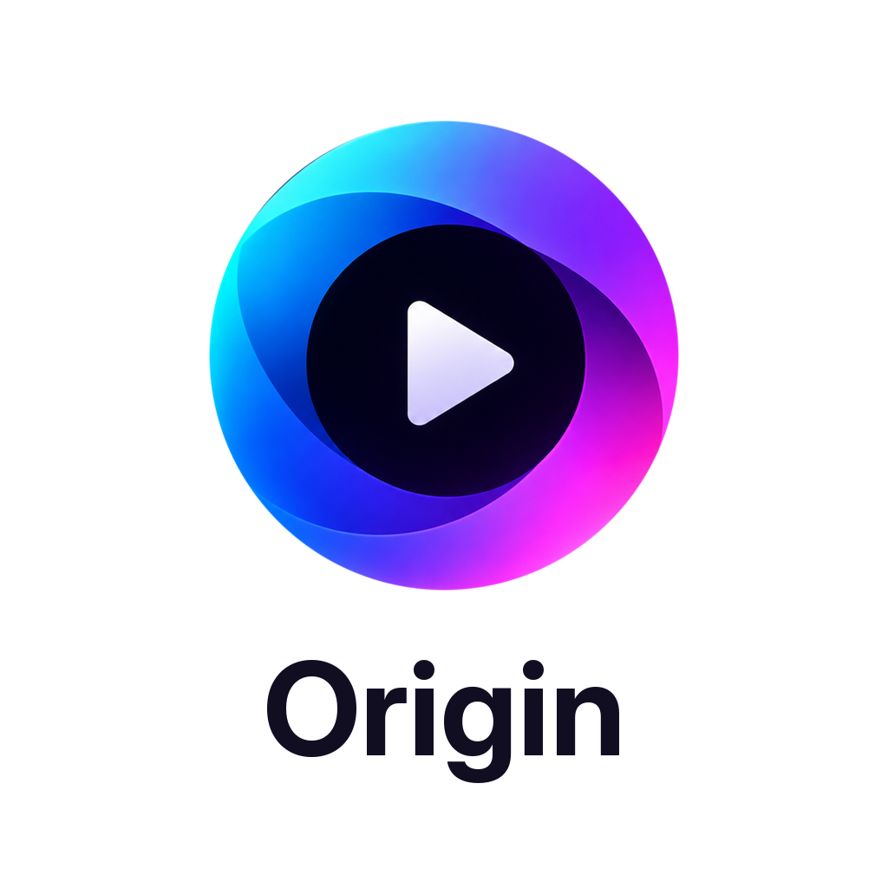

<p align="center">
  
</p>

<h1 align="center">Stremio Origin for Android</h1>

<p align="center">A native app for Stremio addons on Android TV, Google TV, Fire TV and phones, written in C.</p>

<p align="center">The Android build of <a href="https://github.com/betterstremio/webos">Stremio Origin for webOS</a> (GPL-3.0): the same app and the same code, with an Android player underneath.</p>

<p align="center"><em>Stremio™ is a trademark of its owner. Stremio Origin is independent and unofficial, and is not affiliated with, endorsed by or sponsored by Stremio. The name only describes compatibility.</em></p>

<p align="center">You bring your own Stremio account and your own addons. The app ships empty, hosts and indexes nothing, and plays only the stream links your addons return.</p>

## Features
- Home, Discover, Library and Search from your addons, with artwork, logos and trailers
- The best stream for your device and connection, picked in one press
- A player with episodes, sources, subtitles and audio, skip intro and recap, and a next-episode card
- Styled subtitles as the film made them, and subtitle sync
- P2P playback, with a buffer sized to the device's memory and storage
- HDR and Dolby Vision where the device and screen support them; DTS and TrueHD where the device decodes them or passes them to a receiver
- Library, watched state and Continue Watching synced with your Stremio account
- Made for a remote: the arrows, OK and Back do everything; the colour keys work where the remote has them
- On a phone: the TV layout in a 16:9 frame, with taps for the pointer
- 11 languages, including Arabic (right to left)
- Updates from inside the app

## Install
Android 7.0 or later, on ARM (64-bit or 32-bit). One APK for TVs and phones.

1. Download `tv.stremioorigin.app_<version>_android.apk` from [Releases](https://github.com/betterstremio/android/releases).
2. Allow installs from the app you open it with (Android asks the first time).
   - Android TV / Google TV / Fire TV: the Downloader app can fetch the APK from the release link and install it. On Fire TV, turn on Settings > My Fire TV > Developer options > Install unknown apps for Downloader first.
   - Phone: open the downloaded file.
3. Open Stremio Origin and sign in by scanning the code with your phone, or with your email.

Updates: Settings > About shows a new version when there is one. The app downloads it, checks its SHA-256 and hands it to Android's installer. The first time, Android asks you to allow installs from Stremio Origin.

## Status
- Tested on the Google TV emulator (Android 14): sign-in, Home, playback of MP4, MKV and HLS, audio and subtitle tracks, P2P, and an update from one version to the next. The 32-bit ARM build passes the same tests through Android's ARM translation.
- Not yet tested on a real TV box, Fire TV stick or phone. Reports are welcome in [Issues](https://github.com/betterstremio/android/issues): say which device and Android version.
- Not in the Android build yet: the DTS conversion and the USB drive for P2P from the webOS app.

## Privacy
- Sign-in goes directly to Stremio. Your account stays on the device.
- No analytics. Nothing is sent to the developer.
- Logs stay on the device. Sharing them is your choice: the app seals them and shows a short code.

## Building
In Linux or WSL with the Android SDK and NDK r27:
```
tools/android/build-deps.sh                    # SDL2, Mbed TLS, curl for each ABI
tools/build-engine.sh android-arm64-v8a        # the P2P engine (also android-armeabi-v7a, android-x86)
tools/android/build-apk.sh                     # the release APK (arm64-v8a + armeabi-v7a)
tools/android/build-apk.sh --dev               # a test build with x86 for the emulator
```
Automated tests on the emulator: `python tools/android/test/run.py --build` (after `tools/android/test/media.sh`). The script's header says what it needs.

## Support
- Issues: https://github.com/betterstremio/android/issues
- Support: https://ko-fi.com/blueee123

## Credits
- Interface sounds: [Interface Sounds](https://kenney.nl/assets/interface-sounds) by Kenney (CC0).
- The glass look: [liquid-glass-react](https://github.com/rdev/liquid-glass-react) by rdev; the app ships a modified version.
- P2P: [Nuvio Engine](https://github.com/NuvioMedia/nuvio-engine) (GPL-3.0); the app ships a modified version.
- Collections: the format and how sources resolve follow [NuvioTVSmart](https://github.com/NuvioMedia/NuvioTVSmart) (GPL-3.0).
- Video on Android: [AndroidX Media3 / ExoPlayer](https://github.com/androidx/media) (Apache-2.0). Window and input: [SDL](https://libsdl.org) (zlib). Network: [curl](https://curl.se) with [Mbed TLS](https://github.com/Mbed-TLS/mbedtls).

## Licence
GPL-3.0, see [LICENSE](LICENSE). Third-party components and their licences: [third_party/licenses/README.txt](third_party/licenses/README.txt).
